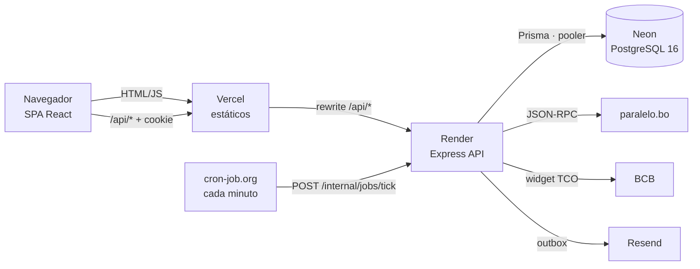
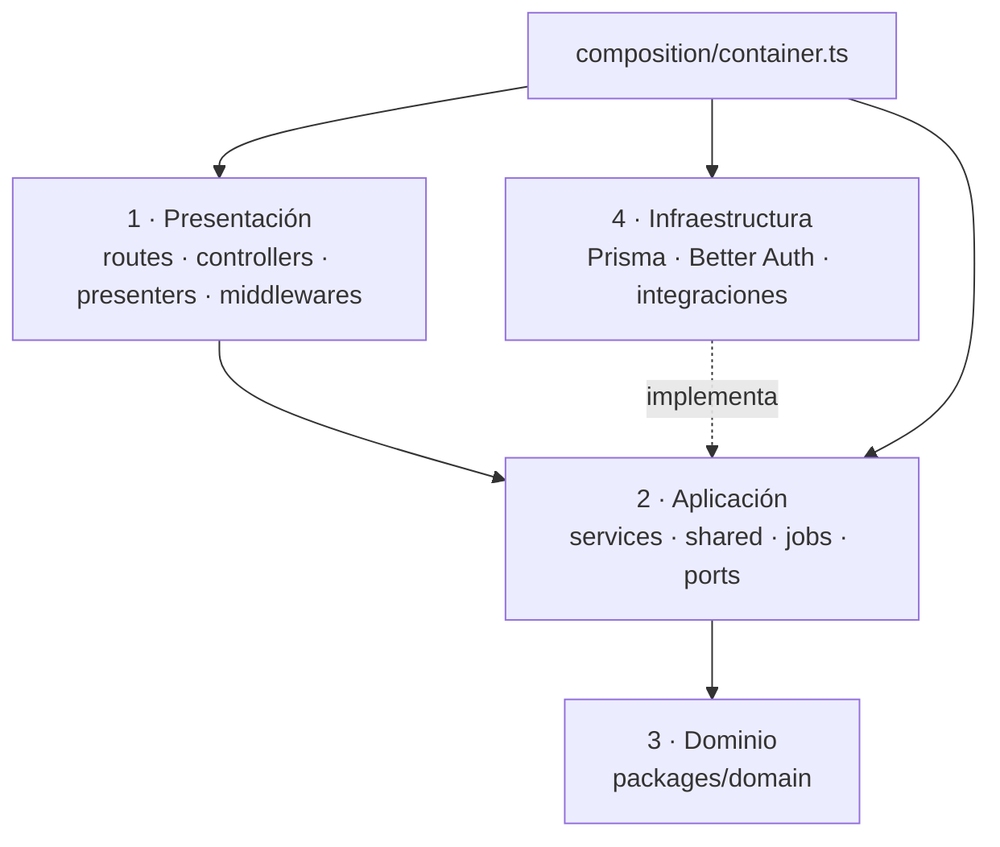

# 🏛️ Arquitectura general

↑ [[MOC Arquitectura]]

Monorepo TypeScript con **pnpm** ([[Monorepo pnpm]]). La app está hecha de tres despliegues separados: la **web** (Vercel), el **API** (Render) y la **base de datos** (Neon). Los une un proxy: el navegador solo habla con el dominio de la web ([[ADR-02 - Sesión entre dominios (proxy de Vercel)]]).

## Piezas

| Pieza | Dónde | Nota |
|---|---|---|
| SPA React + Vite, Tailwind, shadcn/ui, TanStack Query, React Router | `apps/web` | [[Web - Visión general]] |
| API Express en 4 capas | `apps/api` | [[API - Visión general]] |
| Contratos Zod compartidos | `packages/contracts` | [[Paquete contracts]] |
| Reglas puras: dinero, fechas, tasas, períodos, interés | `packages/domain` | [[Paquete domain]] |
| Prisma: schema, migraciones y seed | `packages/db` | [[Paquete db]] · [[Modelo de datos]] |
| TS, ESLint y Vitest compartidos | `packages/config` | [[Paquete config]] |
| E2E con Playwright | `e2e` | [[Pruebas E2E (Playwright)]] |
| Pipeline SDD con agentes | `tools/sdd`, `.claude` | [[Pipeline SDD con agentes]] |

## Principios de diseño ([[Plan 1.1 Capas]])

1. **La identidad sale de la sesión.** Ningún endpoint acepta `userId` del cliente ([[Constitución 4. Seguridad]]).
2. **Las reglas viven una sola vez.** Lo calculable va en `packages/domain`. El API siempre vuelve a validar y tiene la última palabra.
3. **Toda mutación es una transacción.** Los saldos se validan dentro de ella, con bloqueo ([[API - Unit of Work y aislamiento]]).
4. **La historia no se reescribe.** Los movimientos guardan sus tasas ([[Constitución 3. Datos y dinero]]).

## Capas del backend ([[ADR-19 - Backend en capas]])

[[Config - dependency-cruiser]] verifica en CI que las reglas entre capas se cumplan. Detalle de cada capa: [[API - Capa de presentación]], [[API - Capa de aplicación]], [[API - Capa de infraestructura]], [[API - Composición (container.ts)]].

## Decisiones clave

[[ADR-03 - Dinero como decimal]] · [[ADR-04 - Libro contable de doble asiento]] · [[ADR-05 - Aislamiento por usuario]] · [[ADR-11 - Idempotencia con UUID v7]] · [[ADR-18 - Entregas con RELEASE]] · [[ADR-20 - CI-CD con GitHub Actions]]. Lista completa en [[Plan 1.3 Registro de decisiones (ADR)]].
