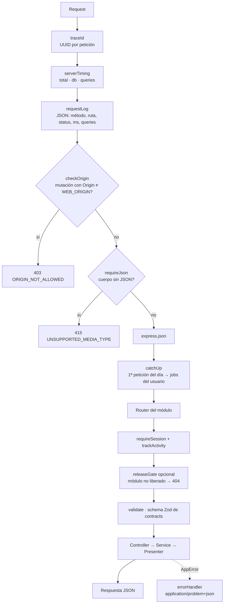

# 🔁 Flujo · Una petición HTTP dentro del API

↑ [[API - Visión general]]

Recorrido de cualquier petición por `apps/api/src/presentation/app.ts`. Todos los endpoints están en el [[Catálogo de endpoints]].

## Piezas

- **Middlewares:** [[API - Middlewares]]
- **Errores:** la aplicación lanza `AppError(code, data)`. El estado HTTP sale del catálogo `ErrorCode` de [[Contrato - errors]], y `errorHandler` responde con `application/problem+json` ([[ADR-09 - Errores problem+json]]). Los errores inesperados responden `INTERNAL_ERROR 500` con un `traceId`, sin detalles internos ([[Constitución 4. Seguridad]]).
- **Contexto de sesión:** `requireSession` resuelve la sesión, el usuario y su zona horaria **en una sola consulta** (RNF-29). La identidad nunca viene del cuerpo.
- **Entregas:** `releaseGate` y la variable `RELEASE` deciden qué módulos existen ([[ADR-18 - Entregas con RELEASE]]).
- **Costo visible:** cada respuesta trae `Server-Timing` ([[Plan 4.0 Elementos transversales]]).
- **Catch-up:** [[Flujo - Tick de jobs]].

## Controlador delgado

Un controlador solo valida, arma `{ userId, timezone, now, traceId }`, llama a **un** método del servicio y presenta el resultado. Toda regla vive en la aplicación o en el dominio ([[API - Capa de presentación]], [[API - Capa de aplicación]]).
