# 🔁 Flujo · Tick de jobs y catch-up

↑ [[API - Visión general]] · Decisión: [[ADR-01 - Jobs con cron externo]] · Diseño: [[Plan 4.0 Elementos transversales]]

En el plan gratis, Render no puede tener un proceso siempre encendido con cron interno. Por eso, **cron-job.org** llama cada minuto a `POST /internal/jobs/tick` con el encabezado `x-jobs-secret`. El ping también mantiene despierto el servidor ([[Latencia - Mantener despiertos los servicios]]).

```mermaid
flowchart LR
  CRON[cron-job.org<br/>cada minuto] -->|x-jobs-secret| TICK[POST /internal/jobs/tick]
  TICK --> J1[fx.fetchParallel] --> J2[fx.fetchOfficial] --> J3[outbox.send] --> J4[recurring.generate]
  J4 --> J5[budgets.close] --> J6[budgets.defaultDecision] --> J7[recurring.expirePending]
  J7 --> J8[notifications.scheduled] --> J9[maintenance]
```

## Reglas

- **Orden fijo y presupuesto de 25 s:** pasado ese tiempo, el tick no empieza más jobs ([[Job - tick]]).
- **Lease en `job_run`:** cada job toma una fila con `locked_until = now + 5 min`. Si otra corrida la tiene, lo salta. Es un lease y no un *advisory lock* de sesión porque el pooler de Neon (PgBouncer en modo transacción) rompe los bloqueos de sesión ([[Entidad - JobRun]], [[Migración 0011_job_run_lease]]).
- **Idempotencia:** claves únicas y transiciones condicionadas. Un job cortado se completa en la corrida siguiente (RNF-13).
- **Por entrega:** un job de un módulo no liberado no corre ([[ADR-18 - Entregas con RELEASE]]).
- **Un fallo no detiene a los demás:** el error queda registrado en `job_run`.

## Catch-up por usuario

La primera petición autenticada de cada usuario en su día local ejecuta `catchUpUser(userId)` sin esperarlo. Corre los mismos jobs, pero solo para ese usuario, por si el cron se atrasó (middleware `catchUp`, [[API - Middlewares]]).

## Jobs

| Job | Módulo | Nota |
|---|---|---|
| `fx.fetchParallel`, `fx.fetchOfficial` | [[M3 - Monedas y tipo de cambio]] | [[Job - fx]] · [[Flujo - Tipo de cambio]] |
| `outbox.send` | [[M1 - Acceso y cuenta]] | [[Job - outbox]] |
| `recurring.generate`, `recurring.expirePending` | [[M14 - Recurrentes]] | [[Job - recurring]] · [[Compartido - recurring-generator]] |
| `budgets.close`, `budgets.defaultDecision` | [[M11 - Presupuestos]] | [[Job - budgets]] |
| `notifications.scheduled` | [[M15 - Recordatorios y avisos]] | [[Job - notifications]] |
| `maintenance` | todos | [[Job - maintenance]] |

Durante un despliegue, un tick que cae mientras Render reinicia simplemente falla, y el del minuto siguiente se pone al día ([[Plan 1.5 Integración y despliegue continuos (ADR-20)]]).
