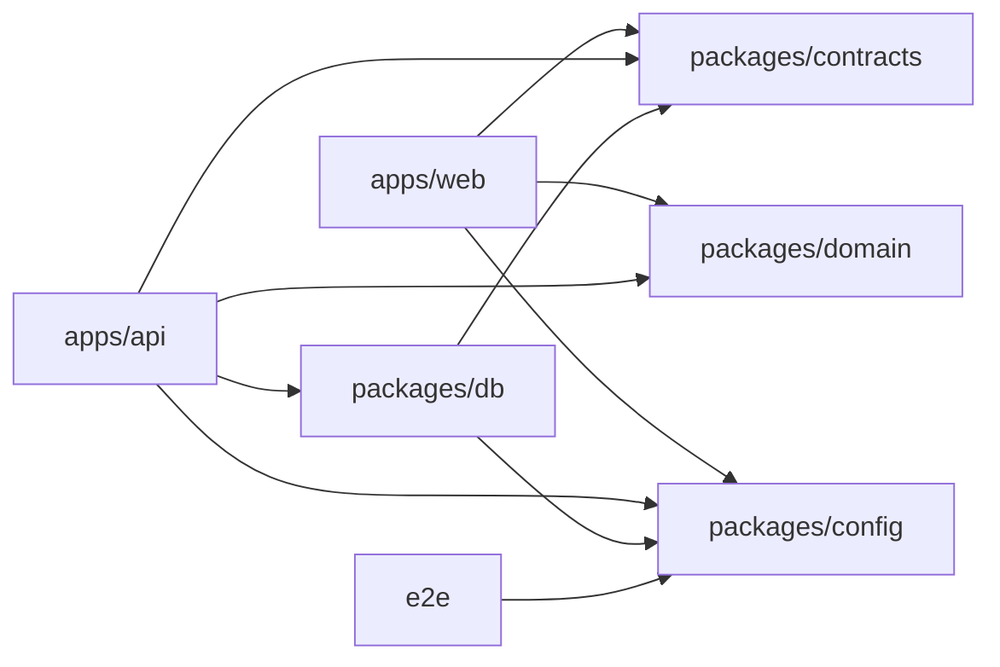

# Monorepo pnpm

↑ [[Arquitectura general]]

El repo es un workspace de **pnpm 11** con Node 22 ([[Config - .nvmrc]]), declarado en [[Config - pnpm-workspace.yaml]] y con los scripts globales de [[Config - package.json raíz]].

```text
apps/api            API Express en capas
apps/web            SPA React + Vite
packages/contracts  Schemas Zod (entrada, salida y errores)
packages/domain     Reglas puras (decimal.js, date-fns)
packages/db         Prisma: schema, migraciones, seed y scripts
packages/config     tsconfig, ESLint y Vitest compartidos
e2e                 Playwright (accesibilidad y rendimiento)
tools/sdd           Scripts del pipeline de tareas
001-appFinanzas-mvp spec.md · plan.md · tasks.md · coherencia.md
docs                constitución, protocolo, diseño, asignaciones y latencia
.claude             agentes, skills, hooks y estado del pipeline
```

Estructura comentada en [[README - Estructura]] y en [[Plan 2. Estructura del Proyecto (Árbol de Directorios)]].

## Dependencias entre paquetes



## Comandos globales

| Comando | Qué hace |
|---|---|
| `pnpm lint` | ESLint estricto en todo el monorepo |
| `pnpm typecheck` | `tsc` en la raíz y en cada paquete |
| `pnpm depcruise` | Reglas de capas del API ([[Config - dependency-cruiser]]) |
| `pnpm test:unit` / `pnpm test:integration` | Vitest en cada paquete |
| `pnpm build` | Build de cada paquete que lo define |
| `pnpm format` | Prettier ([[Config - .prettierrc.json]]) |

Ver [[README - Pruebas y calidad]] y [[Entorno local]].
