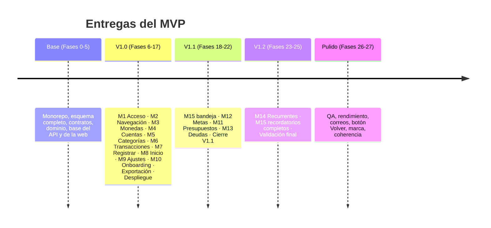

# 📦 Entregas V1.0 · V1.1 · V1.2

↑ [[MOC Features]] · Fuente: [[Spec 1.2 Entregas]] · [[Constitución 1. Producto]]

Cada entrega tenía que quedar **usable a diario** antes de empezar la siguiente. Los módulos de una entrega no liberada **no aparecen** en la interfaz y sus rutas del API responden 404. Lo controla la variable `RELEASE` del API, que se devuelve en `GET /api/me` ([[ADR-18 - Entregas con RELEASE]]).

| Entrega | Módulos | Fases |
|---|---|---|
| **V1.0** | [[M1 - Acceso y cuenta]] · [[M2 - Navegación y estructura]] · [[M3 - Monedas y tipo de cambio]] · [[M4 - Cuentas]] · [[M5 - Categorías]] · [[M6 - Transacciones]] · [[M7 - Registrar]] · [[M8 - Inicio (dashboard)]] · [[M9 - Ajustes y personalización]] · [[M10 - Onboarding]] | 6 a 17 |
| **V1.1** | [[M11 - Presupuestos]] · [[M12 - Metas de ahorro]] · [[M13 - Deudas y préstamos]] · bandeja de [[M15 - Recordatorios y avisos]] | 18 a 22 |
| **V1.2** | [[M14 - Recurrentes]] · [[M15 - Recordatorios y avisos]] completo | 23 a 25 |

## Cómo se aplica en el código

- **API:** `RELEASE` validado en [[API - Configuración env.ts]]; el middleware `releaseGate(module)` ([[API - Middlewares]]); `isReleased(module, release)` en [[Contrato - releases]]. El tick no corre los jobs de módulos no liberados ([[Job - tick]]).
- **Web:** `ReleaseGate` y `releasedModule()` en el [[Web - Router y rutas|router]]. `/ajustes/recordatorios` solo existe desde V1.2.
- **E2E:** los casos etiquetados `@release-1.0` corren con `E2E_RELEASE=1.0` ([[Config - playwright.config.ts]]).

Avance real: [[README - Estado del proyecto]] · Mapa de fases: [[Tareas 1. Mapa de fases y orden de ejecución]].
