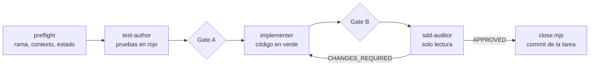

# 🤖 Pipeline SDD con agentes de Claude Code

↑ [[MOC Proceso IA]] · Reglas: [[Constitución 6. Desarrollo guiado por especificaciones (SDD)]] · [[Constitución 8. Ejecución de tareas con agentes]] · Detalle: [[Protocolo de ejecución con agentes]]

Toda funcionalidad siguió el orden **especificación → plan → tareas → implementación** ([[Spec - Especificación funcional]] → [[Plan - Plan de diseño técnico]] → [[Tareas - Backlog del MVP]]). La unidad de trabajo es una tarea `TASK-NNN` de `tasks.md`, y se implementa con la skill `/implement-task`.

## Piezas

| Pieza | Qué hace | Nota |
|---|---|---|
| Skill `/implement-task` | Orquesta el pipeline completo de una tarea | [[Skill - implement-task]] |
| Skill `/fast-task` | Modo rápido sin subagentes ni pruebas nuevas (se usó hasta la Fase 12) | [[Skill - fast-task]] |
| Skill `/coordinar-fases` | Coordina a las personas en las ramas de grupo | [[Skill - coordinar-fases]] |
| `test-author` | Escribe las pruebas desde la spec, antes que el código | [[Agente - test-author]] |
| `implementer` | Escribe el código hasta poner las pruebas en verde, sin tocarlas | [[Agente - implementer]] |
| `sdd-auditor` | Audita contra la constitución, la spec y el plan. No escribe | [[Agente - sdd-auditor]] |
| Hook `SubagentStop` → `gate.mjs` | Gates deterministas: alcance, IDs en las pruebas, tipos, lint, capas y tests. Hasta 3 intentos | [[Config - .claude settings.json]] · [[Protocolo 4. Hooks]] |
| Hook `SessionStart` → `session-brief.mjs` | Resume la rama, la tarea activa y el avance | [[Config - .claude settings.json]] |
| `pre-push` de git | commitlint, secretos y trazabilidad | [[Config - hook pre-push]] |
| `tools/sdd/*.mjs` | preflight, state, context, check, audit, close y coordinate | [[Scripts SDD (tools-sdd)]] |
| `.claude/run/TASK-NNN/` | Estado local de cada ejecución: contexto, auditoría y veredicto | ver abajo |

## Ejecuciones registradas (Fase 27)

| Tarea | Contexto | Auditoría | Veredicto |
|---|---|---|---|
| TASK-271 | [[TASK-271 - Paquete de contexto]] | [[TASK-271 - Auditoría]] | [[TASK-271 - Veredicto]] |
| TASK-272 | [[TASK-272 - Paquete de contexto]] | [[TASK-272 - Auditoría]] | [[TASK-272 - Veredicto]] |
| TASK-273 | [[TASK-273 - Paquete de contexto]] | [[TASK-273 - Auditoría]] | [[TASK-273 - Veredicto]] |
| TASK-274 | [[TASK-274 - Paquete de contexto]] | [[TASK-274 - Auditoría]] | [[TASK-274 - Veredicto]] |

## Coordinación del equipo

Ramas de grupo ([[Config - branch-groups.json]], [[Protocolo 5. Ramas, commits y PR]]) y asignaciones por persona ([[Asignaciones de las Fases 7 a 25]], [[Asignaciones de las Fases 14 a 25]]). Resumen en [[README - Desarrollo guiado por especificaciones (SDD) con agentes]].

## Herramientas MCP

Además del pipeline, el proyecto trae un servidor MCP para que Claude Code consulte la base de datos en desarrollo: [[MCP de Neon]] ([[Config - .mcp.json]], [[Config - neon.mjs]]).
