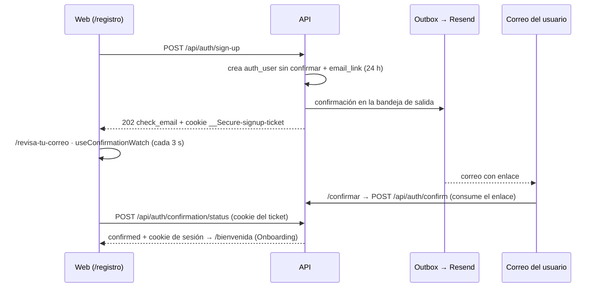

# 🔁 Flujo · Registro, confirmación y sesión

↑ [[M1 - Acceso y cuenta]] · Diseño: [[Plan 4.1 M1 - Acceso y cuenta de usuario (V1.0)]] · Requisitos: [[Spec 2.1 M1 - Acceso y cuenta de usuario (V1.0)]]

La autenticación usa la **API de servidor de Better Auth** (usuario, hash scrypt, sesiones y cookie) detrás de **endpoints propios** `/api/auth/*`. Los enlaces, los bloqueos y los correos los implementa el proyecto ([[ADR-08 - Autenticación sobre Better Auth]]).

## Registro y confirmación (con ticket, Fase 27)

- Las respuestas son **neutras**: no revelan si un correo existe (RNF-15).
- El enlace es de un solo uso (`UPDATE … RETURNING`) y crear uno nuevo invalida el anterior ([[Entidad - EmailLink]]).
- El ticket guarda solo el SHA-256 de la cookie ([[Entidad - SignupTicket]], [[Migración 0013_signup_ticket]]).
- Los registros sin confirmar se descartan a los 7 días ([[Job - maintenance]]).

## Inicio de sesión

- `POST /api/auth/sign-in` verifica la contraseña. Si el correo no existe, también calcula un hash de prueba, para que el tiempo de respuesta sea el mismo.
- Los fallos cuentan en [[Entidad - LoginThrottle]]: con 5 fallos se espera 1 min y con 10, 15 min (`LOGIN_LOCKED 429`) ([[Compartido - login-throttle]]).
- Con éxito, Better Auth crea la sesión y la cookie `HttpOnly; Secure; SameSite=Lax` ([[Entidad - AuthSession]]).

## Sesión en cada petición

- `requireSession` resuelve la cookie y responde `SESSION_EXPIRED` si hubo 30 días sin actividad. `trackActivity` renueva la actividad como máximo cada 5 min, salvo en las peticiones con `X-Background` ([[API - Middlewares]]).
- En la web, un `SESSION_EXPIRED` abre el diálogo de sesión expirada sin navegar ([[Web - Layout (AppShell)]]).
- La cookie funciona en Safari porque Vercel hace de proxy de `/api/*` ([[ADR-02 - Sesión entre dominios (proxy de Vercel)]]).

## Correos de la cuenta

Solo hay **5 tipos** (enum `email_kind`). En la Fase 27 se quitó el aviso de intentos fallidos ([[Migración 0012_remove_login_alert]]). Salen por [[Entidad - EmailOutbox]] → [[Job - outbox]] → [[Integración - Resend]], con reintentos a los 1, 5, 15 y 60 min.

**Archivos:** [[API auth]] · [[API me]] · [[Web - auth]] · [[Web - profile]] · `infrastructure/auth/better-auth.ts`

---
## 🔗 Relacionado

- **Requerimientos no funcionales:** [[Spec 3.5 Privacidad y seguridad]]

