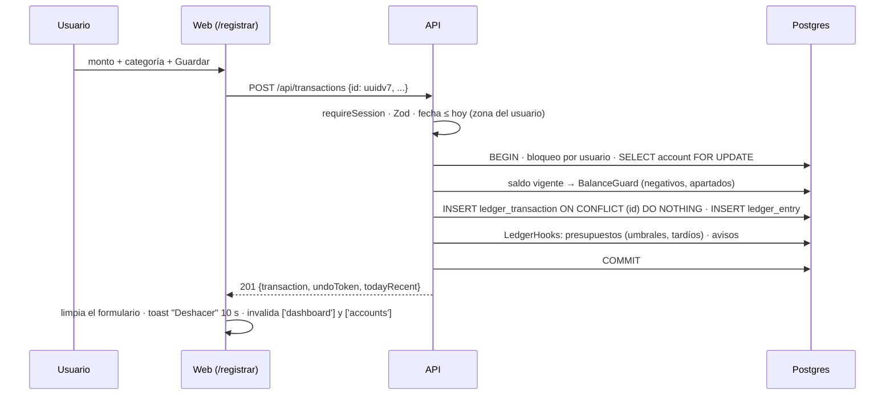

# 🔁 Flujo · Guardar un gasto (camino crítico)

↑ [[Arquitectura general]] · Módulos: [[M7 - Registrar]] → [[M6 - Transacciones]]

Es el flujo más importante del producto ([[Constitución 1. Producto]]): registrar un movimiento en menos de 10 s (RNF-01, RNF-02). Se describe en [[Plan 1.2 Despliegue y flujo principal]] y [[Plan 1.4 Arquitectura por capas del backend (ADR-19)]].

## Paso a paso por capa

| # | Capa | Pieza | Nota |
|---|---|---|---|
| 1 | Web | `RegisterForm` con react-hook-form y el schema de `contracts`; borrador en sessionStorage | [[Web - register]] · [[Web - lib (utilidades)]] |
| 2 | Web | `api-client` llama al endpoint tipado, con un `id` UUID v7 generado en el cliente | [[ADR-11 - Idempotencia con UUID v7]] |
| 3 | Presentación | `checkOrigin` → `requireJson` → `requireSession` → `trackActivity` → `validate(CreateTransactionInput)` | [[API - Middlewares]] · [[Contrato - transactions]] |
| 4 | Presentación | `TransactionsController.create` arma `{ userId, timezone, now, traceId }` | [[API transactions]] |
| 5 | Aplicación | `TransactionsService.create` abre `uow.run(..., { userLock })` | [[API - Unit of Work y aislamiento]] |
| 6 | Aplicación | `accounts.lockForUpdate` → `RatesService.resolveUsdRate` → `BalanceGuard.apply` | [[Compartido - balance-guard]] · [[Dominio - fx]] |
| 7 | Infraestructura | `transactions.insert`: cabecera + asientos con signo | [[Entidad - LedgerTransaction]] · [[Entidad - LedgerEntry]] · [[ADR-04 - Libro contable de doble asiento]] |
| 8 | Aplicación | `LedgerHooks.afterChange` → presupuestos y avisos | [[Compartido - ledger-hooks]] · [[Compartido - budget-ledger-hook]] · [[Compartido - notification-emitter]] |
| 9 | Aplicación | `undoActions.create` → token de "Deshacer" de un solo uso | [[Entidad - UndoAction]] · [[ADR-07 - Deshacer con token]] |
| 10 | Presentación | `TransactionPresenter.toDto` → `201` | [[API - Presentadores]] |

## Reglas que garantizan

- **Sin duplicados:** el mismo `id` responde `200` con el existente; con datos distintos, `IDEMPOTENCY_CONFLICT 409`.
- **Sin carreras:** dos escrituras del mismo usuario se encolan por el bloqueo `pg_advisory_xact_lock` (RNF-10).
- **Dinero exacto:** montos como texto decimal y `NUMERIC` en Postgres ([[ADR-03 - Dinero como decimal]]).
- **Historia fija:** el movimiento guarda `rate_cur_bob` y `rate_usd_bob` (RN-04).

---
## 🔗 Relacionado

- **Decisiones (ADR):** [[ADR-19 - Backend en capas]]
- **Requerimientos no funcionales:** [[Spec 3.1 Tiempos límite]] · [[Spec 3.3 Concurrencia]]
- **Spec / Plan / Constitución:** [[Spec 1.6 Reglas de negocio transversales (RN)]]

