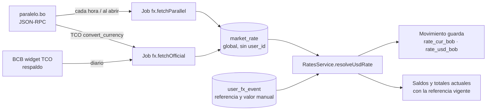

# 🔁 Flujo · Tipo de cambio

↑ [[M3 - Monedas y tipo de cambio]] · Diseño: [[Plan 4.3 M3 - Monedas y tipo de cambio (V1.0)]] · Decisión: [[ADR-06 - Fuentes de tasas de cambio]]

## Conceptos

- **Referencia del dólar:** paralelo (compra, venta o mediana), oficial del BCB (TCO, un solo valor) o un valor manual ([[Spec 1.5 Glosario]]). En el paralelo, "venta" es el mayor de los dos valores y "compra", el menor.
- **Tasa guardada:** cada movimiento guarda sus tasas al guardarse y nunca cambian por el mercado (RN-04, [[Constitución 3. Datos y dinero]]).
- **Datos de mercado globales:** `market_rate` es la única tabla sin `user_id` y solo la escriben los jobs ([[ADR-12 - Datos de mercado globales]]).
- **Conversión:** los saldos actuales usan la referencia vigente; los ingresos y gastos de un período, la tasa guardada (RN-05). Redondeo a 2 decimales con la mitad alejándose del cero (RN-06).

## Piezas

| Pieza | Nota |
|---|---|
| Integraciones | [[Integración - paralelo.bo]] · [[Integración - BCB]] |
| Job | [[Job - fx]] |
| Reglas puras | [[Dominio - fx]] · [[Dominio - money]] |
| Endpoints | [[API fx]] · [[API currencies]] |
| Tablas | [[Entidad - MarketRate]] · [[Entidad - Currency]] · [[Entidad - UserFxEvent]] |
| Web | [[Web - fx]] (pantalla `/tipo-de-cambio`, brecha, historial) |
| Carga del histórico | [[Workflow fx-backfill.yml]] · [[Seeds y scripts de base de datos]] |

---
## 🔗 Relacionado

- **Spec / Plan / Constitución:** [[Spec 1.6 Reglas de negocio transversales (RN)]]

