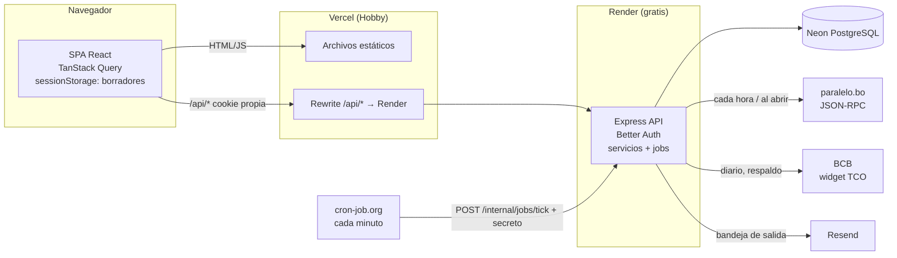
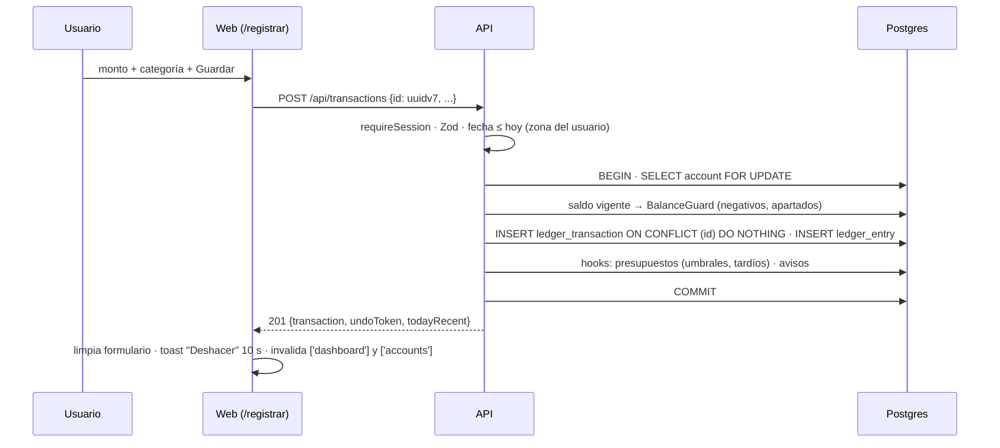

↑ [[Plan 1. Visión Arquitectónica y Flujo del Sistema]] · ← [[Plan 1.1 Capas]] · → [[Plan 1.3 Registro de decisiones (ADR)]]

### 1.2 Despliegue y flujo principal

**Guardar un gasto (camino crítico, RNF-01 y RNF-02):**

**Cómo se conectan las tres partes.** La web, el API y la base de datos son tres despliegues separados, cada uno en su servicio. Cada despliegue verifica los tres enlaces con pruebas de humo (1.5):

| Enlace | Cómo se conecta | Dónde se configura | Prueba de humo |
|---|---|---|---|
| Web (Vercel) → API (Render) | Rewrite de `/api/*` hacia la URL pública del API. El navegador solo ve el dominio de la web: no hace falta CORS y la cookie funciona también en Safari (ADR-02). | `vercel.json` | `GET $WEB_URL/api/health/ready` = 204 |
| API (Render) → BD (Neon) | `DATABASE_URL`, con el pooler de Neon, en tiempo de ejecución. Las migraciones usan `DATABASE_URL_DIRECT`, sin pooler. | Variables de Render y secreto del Environment `production` | `GET $API_URL/api/health/ready` = 204 |
| API ← Web (origen permitido) | `checkOrigin` rechaza las mutaciones cuyo `Origin` no sea la web. | `WEB_ORIGIN` en Render | — |

`GET /api/health` solo dice que el API está vivo. `GET /api/health/ready` hace además una consulta a la base de datos (4.2.2). Si esa consulta responde 204 llamando por el dominio de la web, quedan probadas la web, el API y la base de datos, de punta a punta.

---
## 🔗 Relacionado

- **Decisiones (ADR):** [[ADR-02 - Sesión entre dominios (proxy de Vercel)]]
- **Requerimientos no funcionales:** [[Spec 3.1 Tiempos límite]]

