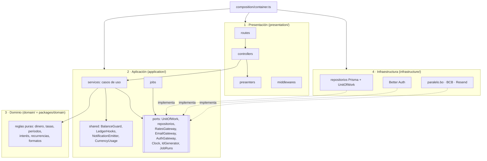

↑ [[Plan 1. Visión Arquitectónica y Flujo del Sistema]] · ← [[Plan 1.3 Registro de decisiones (ADR)]] · → [[Plan 1.5 Integración y despliegue continuos (ADR-20)]]

### 1.4 Arquitectura por capas del backend (ADR-19)

| Capa | Contiene | Puede depender de | NO puede depender de |
|---|---|---|---|
| Presentación | Rutas Express, controladores, middlewares, presentadores (entidad → DTO) y el endpoint interno del tick | Aplicación (servicios y errores), `packages/contracts` | Infraestructura, Prisma, Better Auth |
| Aplicación | Servicios (un caso de uso por método), servicios compartidos, jobs, puertos (interfaces) y catálogo de errores | Dominio, `packages/contracts` (tipos), sus propios puertos | Presentación, infraestructura, `express`, `@prisma/client`, `better-auth` |
| Dominio | `packages/domain` (funciones puras) y tipos de entidad | decimal.js, date-fns | Todo lo demás |
| Infraestructura | Cliente Prisma con la extensión de aislamiento, `UnitOfWork` (transacción + `withUserLock`), repositorios, Better Auth, integraciones y sus *fakes*, configuración, exportación CSV/ZIP | Puertos y tipos de aplicación, dominio | Presentación |
| Composición | `container.ts`: crea las implementaciones y las inyecta en los servicios y controladores | Todas | — |

**Reglas de diseño:**
- **Controladores delgados.** Un controlador solo valida con el schema de `contracts`, arma el contexto `{ userId, timezone, now, traceId }` a partir de la sesión, llama a un solo método de servicio y presenta el resultado. Toda regla de negocio vive en aplicación o dominio.
- **Transacciones solo en aplicación.** Un servicio abre la transacción con `uow.run(fn, { userLock?: userId })`, y los repositorios que recibe ya están ligados a esa transacción y a ese `userId` (ADR-05). Los repositorios nunca abren transacciones.
- **Errores en una sola dirección.** Aplicación lanza `AppError(code, data)`; el `errorHandler` de presentación lo traduce a problem+json (ADR-09). Ningún error de Prisma o de Better Auth cruza hacia la presentación.
- **Fakes de integraciones.** La infraestructura incluye `paralelo-bo.fake`, `bcb.fake` y `resend.fake`, activados con `INTEGRATIONS=fake`. La validación de `env` lo prohíbe en producción.

**Ejemplo, `POST /api/transactions`:** `transactions.routes` → `TransactionsController.create` (valida `CreateTransactionInput` y arma el contexto) → `TransactionsService.create(ctx, input)`. El servicio abre `uow.run` y, dentro de esa transacción:
1. `accounts.lockForUpdate`;
2. `RatesService.resolveUsdRate` (dominio);
3. `BalanceGuard.apply`;
4. `transactions.insert`;
5. `LedgerHooks.afterChange`;
6. `undoActions.create`.

Al final, `TransactionPresenter.toDto` arma la respuesta `201`.

**Cumplimiento automático:** `.dependency-cruiser.cjs` define las reglas `presentation-not-to-infrastructure`, `application-not-to-presentation`, `application-not-to-infrastructure`, `application-no-framework` (sin `express`, `@prisma/client` ni `better-auth`), `domain-pure` e `infrastructure-not-to-presentation`. CI falla ante cualquier violación.

**Tests por capa:**

| Capa | Cómo se prueba |
|---|---|
| Dominio | Unitarios puros. |
| Aplicación | Unitarios con repositorios en memoria y `Clock` falso para la lógica de orquestación, más integración con la infraestructura real para la concurrencia. |
| Infraestructura | Integración contra Postgres en Docker, incluidos los tests de aislamiento (§5). |
| Presentación | Contratos HTTP con supertest. |

---
## 🔗 Relacionado

- **Decisiones (ADR):** [[ADR-05 - Aislamiento por usuario]] · [[ADR-09 - Errores problem+json]] · [[ADR-19 - Backend en capas]] · [[ADR-20 - CI-CD con GitHub Actions]]

