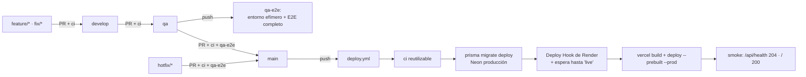

↑ [[Plan 1. Visión Arquitectónica y Flujo del Sistema]] · ← [[Plan 1.4 Arquitectura por capas del backend (ADR-19)]]

### 1.5 Integración y despliegue continuos (ADR-20)

**Entornos:**

| Entorno | Rama | Backend | Base de datos | Frontend | Cómo se actualiza |
|---|---|---|---|---|---|
| Producción | `main` | Render (plan gratis, `autoDeploy: false`) | Neon, rama `main` | Vercel, producción (despliegue por Git desactivado) | `deploy.yml`, automático en cada push a `main` con CI en verde |
| QA (efímero) | `qa` | API dentro del runner de GitHub Actions | Postgres 16 como *service* del job | `vite build` + `vite preview` con proxy al API | `qa-e2e.yml` en cada push a `qa` y en cada PR hacia `main` |
| Integración | `develop` | — | — | — | Solo CI (`ci.yml`) |

**Flujo (Git Flow de la constitución §7):**

**Workflows (`.github/workflows/`):**

| Archivo | Disparador | Pasos |
|---|---|---|
| `ci.yml` | `push` a cualquier rama y `pull_request` hacia `develop`, `qa` y `main`. También es reutilizable (`workflow_call`). | 1) `pnpm install --frozen-lockfile` con caché y generación del cliente Prisma (`pnpm --filter @finanzas/db generate`): el lint con tipos y el typecheck leen sus tipos, y sin generarlo valen `any`. 2) commitlint de los commits del PR. 3) lint (ESLint, i18n, sin literales). 4) typecheck estricto. 5) dependency-cruiser (reglas de capas). 6) Unitarios (`domain`, `contracts`, aplicación). 7) Integración del API contra Postgres 16 como *service* (`prisma migrate deploy` + Vitest), incluidos aislamiento y concurrencia. 8) Build de `api` y `web`. |
| `qa-e2e.yml` | `push` a `qa` y `pull_request` hacia `main` | Levanta el entorno efímero: Postgres como *service*, migraciones, `seed:e2e` (usuarios de prueba, 5.000 movimientos, tasas fijas), API con `INTEGRATIONS=fake` (los correos se capturan en un buzón de prueba para leer los enlaces), web compilada en `vite preview`. Corre Playwright en la matriz Chromium/WebKit/Firefox × 360/1280 px (en paralelo), axe y la suite de rendimiento (RNF-01 a RNF-03). Publica el reporte, las trazas y los videos de los fallos como artefactos. |
| `deploy.yml` | `push` a `main` (incluye merges de `qa` y `hotfix/*`) y `workflow_dispatch`, para volver a desplegar sin un commit | `concurrency: production` (sin cancelar despliegues en curso). Hay dos jobs. El primero, `uses: ./.github/workflows/ci.yml`: si CI falla, no se despliega. El segundo, `deploy`, corre en el *GitHub Environment* `production` y en un runner propio, así que prepara su entorno: checkout, `pnpm/action-setup`, `setup-node` con `.nvmrc` y `pnpm install --frozen-lockfile`. 1) `prisma migrate deploy` con `DATABASE_URL` y `DATABASE_URL_DIRECT` iguales a la conexión directa de Neon: Prisma exige la variable de `url` aunque migre por `directUrl`. 2) `curl -X POST $RENDER_DEPLOY_HOOK_URL`. Toma el ID del deploy de la respuesta (si no viene, busca el deploy cuyo `commit.id` es `github.sha`) y consulta `GET /v1/services/{id}/deploys/{deployId}` cada 15 s hasta `live`. Falla ante cualquier estado final distinto (`build_failed`, `update_failed`, `pre_deploy_failed`, `canceled` o `deactivated`) o a los 15 min; Render conserva la versión anterior. No usa `deploys?limit=1`, que puede devolver el deploy anterior y dar un falso verde. 3) `vercel pull --yes --environment=production` → `vercel build --prod` → `vercel deploy --prebuilt --prod`, todos con `--token`. Sin `--yes`, `vercel pull` pide confirmación y el job se cuelga. 4) Pruebas de humo, una por enlace (1.2), con las variables `API_URL` y `WEB_URL` del Environment: `GET $API_URL/api/health` = 204 (el API está vivo), `GET $API_URL/api/health/ready` = 204 (el API llega a la BD), `GET $WEB_URL/` = 200 (la web está viva) y `GET $WEB_URL/api/health/ready` = 204 (web → API → BD). |
| `fx-backfill.yml` | Manual (`workflow_dispatch`) | Ejecuta una vez `packages/db/scripts/fx-backfill.ts` contra producción (ADR-06). |

**Configuración versionada en el repo:**
- **`render.yaml` (Blueprint):** define el servicio `finanzas-api` con estos valores:
  - plan gratis y `autoDeploy: false`;
  - `buildCommand`: `corepack enable && pnpm install --frozen-lockfile --prod=false && pnpm --filter @finanzas/db generate && pnpm --filter api build`. Hacen falta las devDependencies porque `start` corre con `tsx`, y el cliente de Prisma se genera en el build. El `build` del API solo verifica tipos: no emite JS;
  - `startCommand`: `pnpm --filter api start`;
  - `healthCheckPath`: `/api/health`;
  - variables con valor fijo: `NODE_ENV=production` (`env.ts` lo exige) y `NODE_VERSION=22`, igual que `.nvmrc`, para que Render no elija otra versión por el `engines: >=22`;
  - variables con `sync: false`, que se cargan en el panel de Render y no en el repo: `DATABASE_URL` (con pooler), `AUTH_SECRET`, `HMAC_SECRET`, `JOBS_SECRET`, `RESEND_API_KEY`, `EMAIL_FROM` (remitente con el dominio verificado en Resend), `RELEASE`, `WEB_ORIGIN` e `INTEGRATIONS=real`. `RESEND_API_KEY` es obligatoria desde el primer arranque, porque `env.ts` la valida aunque todavía no se manden correos.
- **`vercel.json`** (en la raíz del monorepo):
  - `"git": { "deploymentEnabled": false }`, así solo despliega `deploy.yml`;
  - `installCommand: "pnpm install --frozen-lockfile"`, `buildCommand: "pnpm --filter web build"` y `outputDirectory: "apps/web/dist"`;
  - los rewrites, en este orden: primero `/api/:path*` → `<URL pública del API en Render>/api/:path*` (ADR-02), después el de la SPA, `/(.*)` → `/index.html`;
  - `.vercel/`, que crea `vercel link`, va al `.gitignore`.
- **`commitlint.config.cjs`** y **`.dependency-cruiser.cjs`**.

**Secretos:**
- Los de despliegue viven en el *GitHub Environment* `production`, restringido a la rama `main`: `DATABASE_URL_DIRECT`, `RENDER_DEPLOY_HOOK_URL`, `RENDER_API_KEY`, `RENDER_SERVICE_ID`, `VERCEL_TOKEN`, `VERCEL_ORG_ID`, `VERCEL_PROJECT_ID`. Las URLs públicas, `WEB_URL` y `API_URL`, son variables del Environment, no secretos.
- Los de ejecución viven solo en Render.
- Ningún secreto aparece en logs (constitución §4): los pasos usan `::add-mask::`.

**Protección de ramas (§7):**
- `develop`, `qa` y `main` solo aceptan cambios por PR y exigen el check `ci`, desde el primer despliegue.
- `main` exige además `qa-e2e` cuando ese workflow exista (TASK-172). Hasta entonces, `ci` alcanza para desplegar.
- Nadie, ni los agentes de IA, empuja directo a esas ramas.
- Un `hotfix/*` sale de `main`, entra a `main` por PR y después se integra en `qa` y en `develop` con dos PR más.

**Migraciones seguras:**
- Las migraciones siguen el patrón *expand–contract*: cada migración es compatible con la versión anterior del API. Por eso migrar antes de desplegar no rompe la versión que sigue en línea, y volver atrás la app no exige revertir la base.
- Los cambios destructivos (borrar o renombrar columnas) se hacen en dos despliegues.
- No hay migraciones *down* automáticas.

**Vuelta atrás:**
- **API:** "Rollback" al despliegue anterior en Render.
- **Web:** `vercel rollback` o *Instant Rollback* desde el panel de Vercel.
- **Base de datos:** gracias a *expand–contract*, no hace falta tocarla.

**Jobs durante un despliegue:** cron-job.org sigue llamando al tick de producción. Un tick que cae mientras Render reinicia simplemente falla, y el siguiente minuto se pone al día, porque los jobs son idempotentes (ADR-01).

**Costo:** USD 0. GitHub Actions es gratis en repos públicos, y en privados da 2.000 min al mes; cada corrida de CI toma unos 8 min y `qa-e2e` unos 20 min, en paralelo. Render y Vercel siguen en sus planes gratis.

**Puesta en marcha (una sola vez).** Lo que una persona hace a mano: los agentes no pueden crear cuentas ni cargar secretos. El paso a paso está en los «Pasos manuales» de TASK-171, TASK-172, TASK-173 y TASK-174, y reunido en el README.
1. **Neon:** el proyecto, su rama `main` y las URLs con pooler y directa.
2. **Resend:** la cuenta, el dominio verificado (registros DNS de SPF y DKIM) y la API key restringida a ese dominio. Con el remitente de pruebas `onboarding@resend.dev` solo se puede escribir al correo dueño de la cuenta de Resend.
3. **Secretos de la app:** `AUTH_SECRET`, `HMAC_SECRET` y `JOBS_SECRET`, aleatorios.
4. **Vercel:** el proyecto vinculado con `vercel link`, el token y `WEB_URL`.
5. **Render:** el Blueprint desde `render.yaml` en `main`, sus variables, el Deploy Hook, la API key, el ID del servicio y `API_URL`.
6. **GitHub:** el Environment `production` con sus secretos y variables, y la protección de ramas.
7. **cron-job.org:** `POST $API_URL/internal/jobs/tick` cada minuto, con `x-jobs-secret`, `Content-Type: application/json` y el cuerpo `{}` (`requireJson` responde 415 a un POST sin JSON).
8. **Primer despliegue:** la promoción `develop` → `qa` → `main` por PR.

---

---
## 🔗 Relacionado

- **Decisiones (ADR):** [[ADR-01 - Jobs con cron externo]] · [[ADR-02 - Sesión entre dominios (proxy de Vercel)]] · [[ADR-06 - Fuentes de tasas de cambio]] · [[ADR-19 - Backend en capas]] · [[ADR-20 - CI-CD con GitHub Actions]]
- **Requerimientos no funcionales:** [[Spec 3.1 Tiempos límite]]
- **Fases de tareas:** [[Tareas Fase 17 - Cierre de V1.0 rendimiento, accesibilidad y despliegue]]
- **Spec / Plan / Constitución:** [[Constitución 4. Seguridad]] · [[Constitución 7. Git Flow]]

