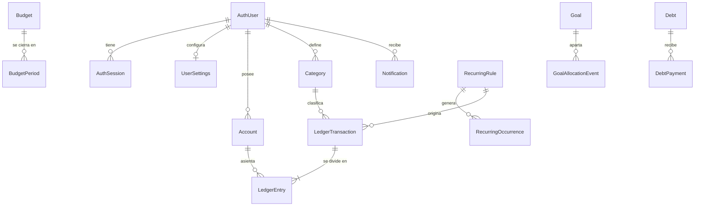

# 🗄️ Modelo de datos

↑ [[MOC Datos]] · Paquete: [[Paquete db]] · Diseño: [[Plan 3. Esquema de Datos y Persistencia Global]]

PostgreSQL 16 (Neon en producción, Docker en local) a través de Prisma. Hay **33 modelos** y **34 enums** ([[Enums de Prisma]]). Convenciones ([[Plan 3.1 Convenciones]]):

- Las tablas y columnas están en inglés y en `snake_case` (`@@map` / `@map`).
- Toda tabla de usuario lleva `user_id`, con `@@unique([userId, id])` para las claves foráneas compuestas ([[ADR-05 - Aislamiento por usuario]]). La excepción es `market_rate` ([[ADR-12 - Datos de mercado globales]]).
- Los ids son UUID v7 generados por el cliente ([[ADR-11 - Idempotencia con UUID v7]]).
- El dinero es `NUMERIC(14,2)` y el interés `NUMERIC(24,10)` ([[ADR-03 - Dinero como decimal]], [[ADR-14 - Interés de deudas como foto]]).
- Lo que Prisma no expresa vive en el SQL de las migraciones: `CHECK`, índices parciales, triggers y funciones ([[ADR-10 - Esquema Prisma más SQL]]).

## Mapa por dominio

| Dominio | Entidades | Plan |
|---|---|---|
| Cuenta de usuario y seguridad ([[M1 - Acceso y cuenta]]) | [[Entidad - AuthUser]] · [[Entidad - AuthSession]] · [[Entidad - AuthAccount]] · [[Entidad - AuthVerification]] · [[Entidad - EmailLink]] · [[Entidad - SignupTicket]] · [[Entidad - LoginThrottle]] · [[Entidad - EmailOutbox]] · [[Entidad - EmailSendLog]] | [[Plan 3.3 Cuenta de usuario y seguridad (M1)]] |
| Ajustes y tipo de cambio ([[M3 - Monedas y tipo de cambio]], [[M9 - Ajustes y personalización]]) | [[Entidad - MarketRate]] · [[Entidad - Currency]] · [[Entidad - UserFxEvent]] · [[Entidad - UserSettings]] · [[Entidad - FavoriteCategory]] | [[Plan 3.4 Ajustes y tipo de cambio (M3, M9, M10)]] |
| Cuentas, categorías y libro ([[M4 - Cuentas]] a [[M7 - Registrar]]) | [[Entidad - Account]] · [[Entidad - Category]] · [[Entidad - LedgerTransaction]] · [[Entidad - LedgerEntry]] · [[Entidad - UndoAction]] · [[Entidad - Shortcut]] | [[Plan 3.5 Cuentas, categorías y libro contable (M4 a M7)]] |
| Planificación ([[M11 - Presupuestos]] a [[M14 - Recurrentes]]) | [[Entidad - Budget]] · [[Entidad - BudgetPeriod]] · [[Entidad - BudgetLateAdjustment]] · [[Entidad - BudgetThresholdHit]] · [[Entidad - Goal]] · [[Entidad - GoalAllocationEvent]] · [[Entidad - Debt]] · [[Entidad - DebtPayment]] · [[Entidad - RecurringRule]] · [[Entidad - RecurringOccurrence]] | [[Plan 3.6 Planificación (M11 a M14)]] |
| Avisos e infraestructura ([[M15 - Recordatorios y avisos]]) | [[Entidad - Notification]] · [[Entidad - NotificationPreference]] · [[Entidad - JobRun]] | [[Plan 3.7 Avisos e infraestructura (M15)]] |

Integridad y cascadas: [[Plan 3.8 Integridad y cascadas]]. Seguridad a nivel de datos: [[Plan 3.9 Seguridad a nivel de datos]].

## El libro contable ([[ADR-04 - Libro contable de doble asiento]])

Cada movimiento es una cabecera `ledger_transaction` (tipo, fecha, categoría y tasas guardadas) con uno o más asientos con signo en `ledger_entry` (cuenta y monto). **Saldo = saldo inicial + Σ asientos** desde la fecha del saldo inicial (RN-01). Una transferencia tiene dos asientos, y su comisión es una transacción hija (`parent_transaction_id`). El borrado es lógico (`deleted_at`) para poder deshacerlo ([[ADR-07 - Deshacer con token]]).

## Migraciones

[[Migración 0001_base]] → [[Migración 0002_auth]] → [[Migración 0003_fx_settings]] → [[Migración 0004_account]] → [[Migración 0005_category]] → [[Migración 0006_ledger]] → [[Migración 0007_budgets]] → [[Migración 0008_goals_debts]] → [[Migración 0009_recurring_notifications]] → [[Migración 0010_deferred_fks]] → [[Migración 0011_job_run_lease]] → [[Migración 0012_remove_login_alert]] → [[Migración 0013_signup_ticket]]

El esquema completo (también las tablas de V1.1 y V1.2) se creó en la Fase 1 ([[Tareas Fase 1 - Esquema de datos]]). La migración 0011 (lease de los jobs) llegó en la [[Tareas Fase 4 - Base del API|Fase 4]], y la 0012 y la 0013 (correos de la cuenta y ticket de registro) en la [[Tareas Fase 27 - Pulido transversal rendimiento, correos, navegación y marca|Fase 27]].

---
## 🔗 Relacionado

- **Módulos:** [[M10 - Onboarding]]
- **Spec / Plan / Constitución:** [[Spec 1.6 Reglas de negocio transversales (RN)]]

