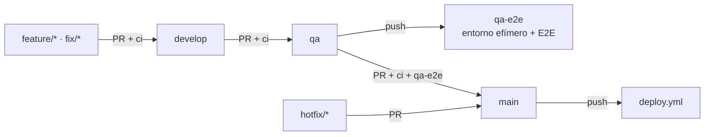
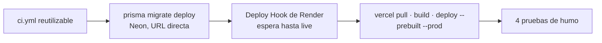

# 🚀 Flujo · Del commit a producción

↑ [[MOC DevOps]] · Decisión: [[ADR-20 - CI-CD con GitHub Actions]] · Diseño: [[Plan 1.5 Integración y despliegue continuos (ADR-20)]]

## Ramas (Git Flow, [[Constitución 7. Git Flow]])

`develop`, `qa` y `main` solo aceptan PR con el check `ci`, y nadie, tampoco los agentes, empuja directo. Los commits siguen Conventional Commits ([[Config - commitlint]]) y pasan antes por el hook [[Config - hook pre-push]].

## Despliegue (`deploy.yml`)

| Prueba de humo | Qué prueba |
|---|---|
| `GET $API_URL/api/health` → 204 | El API está vivo |
| `GET $API_URL/api/health/ready` → 204 | El API llega a la base |
| `GET $WEB_URL/` → 200 | La web está viva |
| `GET $WEB_URL/api/health/ready` → 204 | Web → API → BD de punta a punta |

Si un paso falla, el workflow se detiene y la versión anterior sigue en línea. Las migraciones son *expand–contract*: migrar antes de desplegar no rompe el API que sigue en línea.

## Workflows

- [[Workflow ci.yml]]: CI en cada push y PR
- [[Workflow qa-e2e.yml]]: E2E en el entorno efímero
- [[Workflow deploy.yml]]: producción
- [[Workflow fx-backfill.yml]]: carga única del histórico de tasas

## Servicios

| Parte | Servicio | Configuración |
|---|---|---|
| Web | Vercel (Hobby), sin despliegue por Git | [[Config - vercel.json]] |
| API | Render (gratis, Virginia), `autoDeploy: false` | [[Config - render.yaml]] |
| BD | Neon PostgreSQL (pooler + URL directa) | [[Latencia del despliegue]] |
| Cron | cron-job.org → `POST /internal/jobs/tick` cada minuto | [[Flujo - Tick de jobs]] |

Puesta en marcha manual (una vez): [[README - Puesta en marcha del despliegue (una sola vez)]]. Secretos: [[Variables de entorno]]. Vuelta atrás: rollback en Render y `vercel rollback`; la base no se toca.
