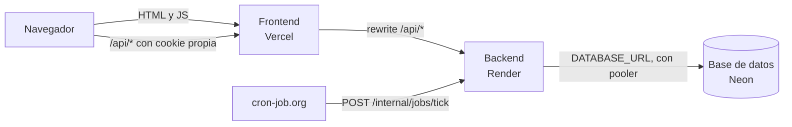

↑ [[README - App de Finanzas Personales]] · → [[README - Equipo]]

## Despliegues

Son tres despliegues separados, cada uno en su servicio, y se actualizan solos desde `main` con `deploy.yml`:

| Parte                          | Servicio | URL                                     | Se verifica con                    |
| ------------------------------ | -------- | --------------------------------------- | ---------------------------------- |
| **Frontend** (React + Vite)    | Vercel   | <https://finanzas-web-orpin.vercel.app> | `GET <web>/` → 200                 |
| **Backend** (Express API)      | Render   | <https://finanzas-api-va.onrender.com>  | `GET <api>/api/health` → 204       |
| **Base de datos** (PostgreSQL) | Neon     | sin URL pública: solo la usa el API     | `GET <api>/api/health/ready` → 204 |

### Cómo se conectan

- **Frontend → Backend:** Vercel reenvía `/api/*` al API de Render. El navegador solo ve el dominio de la web, así que no hace falta CORS y la cookie de sesión funciona también en Safari (ADR-02).
- **Backend → Base de datos:** el API usa `DATABASE_URL` (con el pooler de Neon). Las migraciones usan `DATABASE_URL_DIRECT`.
- **Prueba de punta a punta:** cada despliegue corre cuatro pruebas de humo, una por enlace. La última, `GET <web>/api/health/ready` → 204, pasa por la web, el API y la base de datos a la vez. Para mostrarlo, basta con abrir <https://finanzas-web-orpin.vercel.app/api/health/ready> en el navegador: responde vacío (204) si todo está conectado.

---
## 🔗 Relacionado

- **Decisiones (ADR):** [[ADR-02 - Sesión entre dominios (proxy de Vercel)]]

