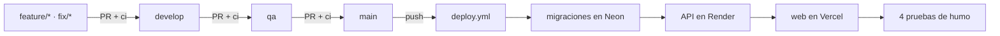

↑ [[README - App de Finanzas Personales]] · ← [[README - Pruebas y calidad]] · → [[README - Desarrollo guiado por especificaciones (SDD) con agentes]]

## Integración y despliegue continuos

| Workflow                                               | Cuándo corre                      | Qué hace                                                                                                                                             | Estado |
| ------------------------------------------------------ | --------------------------------- | ---------------------------------------------------------------------------------------------------------------------------------------------------- | ------ |
| [[Workflow ci.yml\|ci.yml]]                   | En cada push y PR                 | Instalación, commitlint, lint, typecheck, dependency-cruiser, unitarias, integración con Postgres 16 y build                                         | Activo |
| [[Workflow deploy.yml\|deploy.yml]]           | En cada push a `main` y a mano    | CI, luego migraciones, despliegue del API, despliegue de la web y pruebas de humo. Si un paso falla, se detiene y queda en línea la versión anterior | Activo |
| [[Workflow qa-e2e.yml\|qa-e2e.yml]]           | En cada push a `qa` y PR a `main` | E2E con Playwright, accesibilidad y rendimiento en un entorno efímero, en 3 navegadores a 360 px y 1280 px                                           | Activo |
| [[Workflow fx-backfill.yml\|fx-backfill.yml]] | Solo a mano                       | Carga única del historial de tipo de cambio en producción. Es idempotente                                                                            | Activo |

Las ramas siguen Git Flow ([[Constitución|constitución §7]]): `feature/*` sale de `develop` y vuelve por PR. La promoción es `develop` → `qa` → `main`, siempre por PR. Los commits siguen Conventional Commits.

---
## 🔗 Relacionado

- **Spec / Plan / Constitución:** [[Constitución 7. Git Flow]]

