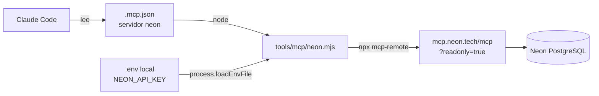

# 🔌 MCP de Neon para Claude Code

↑ [[MOC Proceso IA]] · Fuente: [[README - MCP de Neon (Claude Code)]] · PR #54 (`chore/53-mcp-neon`)

Conecta Claude Code con el servidor MCP de **Neon** para listar tablas, ver el esquema y consultar la base de datos mientras se desarrolla. **Es solo para desarrollo local**: la aplicación no lo lee y no se despliega ([[Flujo - Despliegue a producción]]).

## Piezas

| Pieza | Qué hace | Nota |
|---|---|---|
| `.mcp.json` | Declara el servidor `neon` y el comando que lo lanza | [[Config - .mcp.json]] |
| `tools/mcp/neon.mjs` | Carga `.env`, toma la clave y arranca `mcp-remote` | [[Config - neon.mjs]] |
| `NEON_API_KEY` | API key de Neon (Console → Settings → API keys) | [[Variables de entorno]] |
| `NEON_MCP_READONLY` | `true` por defecto; `false` permite escrituras | [[Variables de entorno]] |

## Por qué un lanzador

Claude Code **no lee `.env`**, así que el script lo carga por su cuenta. La clave nunca se escribe en el repo ni en la línea de comandos: viaja en una variable de entorno del proceso hijo. `stdout` es el canal del protocolo MCP, por eso los avisos van a `stderr`.

## Reglas de seguridad

- La clave se pega **solo en el `.env` local**, que `.gitignore` excluye. En el repo solo está el nombre de la variable ([[Config - .env.example]]).
- Se pasa por un canal privado, nunca por el repositorio ni por un chat grupal. Si el proyecto de Neon es de otra persona, esa persona crea la clave o invita a la otra al proyecto.
- Por defecto queda en **solo lectura**. Con `NEON_MCP_READONLY=false`, el MCP puede modificar la base a la que apunta la clave.

## Activarlo

1. Conseguir la API key de Neon.
2. Pegarla en el `.env` como `NEON_API_KEY=…`.
3. Reiniciar Claude Code en la carpeta del proyecto, aprobar el servidor `neon` y comprobar con `/mcp` que aparece conectado.

Relacionado con el resto del proceso: [[Pipeline SDD con agentes]] · [[Config - .claude settings.json]] · [[Latencia del despliegue]] (la base es Neon, ver [[Modelo de datos]]).
