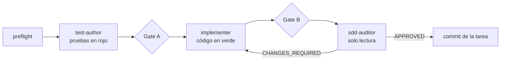

↑ [[README - App de Finanzas Personales]] · ← [[README - Integración y despliegue continuos]] · → [[README - Secretos y variables]]

## Desarrollo guiado por especificaciones (SDD) con agentes

Toda funcionalidad sigue el orden **especificación → plan → tareas → implementación**. Cada tarea de [[Tareas - Backlog del MVP|tasks.md]] se implementa con la skill `/implement-task TASK-NNN`, que reparte el trabajo entre tres subagentes:

| Subagente     | Qué hace                                                                    |
| ------------- | --------------------------------------------------------------------------- |
| `test-author` | Escribe las pruebas a partir de la spec, antes del código                   |
| `implementer` | Escribe el código hasta poner las pruebas en verde, sin tocarlas            |
| `sdd-auditor` | Audita el cambio contra la constitución, la spec y el plan. No escribe nada |

| Hook                                           | Cuándo corre                             | Qué hace                                                                                                                                                                          |
| ---------------------------------------------- | ---------------------------------------- | --------------------------------------------------------------------------------------------------------------------------------------------------------------------------------- |
| `SubagentStop` → `tools/sdd/gate.mjs`          | Cuando termina un subagente del pipeline | Aplica el gate de la etapa: alcance de archivos, IDs en las pruebas, tipos, lint, capas, pruebas y comandos. Si falla, el subagente sigue trabajando, con un máximo de 3 intentos |
| `SessionStart` → `tools/sdd/session-brief.mjs` | Al abrir o retomar una sesión de Claude  | Resume la rama, la tarea activa, el avance y las próximas tareas disponibles                                                                                                      |
| `pre-push` de git → `tools/sdd/pre-push.mjs`   | Antes de cada push                       | Commitlint, secretos y trazabilidad de las tareas, en segundos. La suite completa la corre CI                                                                                     |

Antes de terminar, cada subagente corre `node tools/sdd/check.mjs`, que aplica los mismos controles del gate sin gastar intentos. El detalle está en el [[Protocolo de ejecución con agentes|protocolo de ejecución]].
